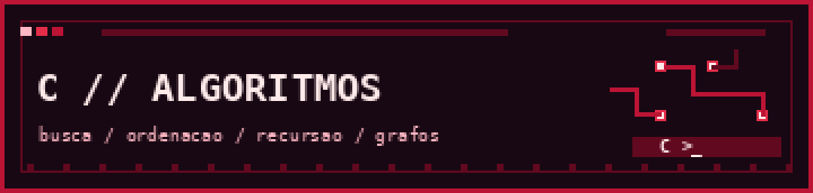

<p align="center">
  
</p>

# Algoritmos em C


Códigos de estudo organizados por assunto. Alguns exercícios podem ter sido desenvolvidos com apoio de aulas e materiais didáticos; referências devem ser registradas quando aplicável.

## `01 / pastas`

| Pasta | Conteúdo |
|:--|:--|
| `busca/` | Pesquisa binária |
| `ordenacao/` | Selection sort e quicksort |
| `grafos/` | Busca em largura (BFS) com fila encadeada |
| `recursao/` | Soma recursiva |

## `02 / execução`

Cada arquivo é independente. Exemplo com GCC:

```bash
gcc -std=c11 -Wall -Wextra ordenacao/quicksort.c -o quicksort
./quicksort
```

No Windows, execute `quicksort.exe`.

## `03 / próximas melhorias`

- Revisar tratamento de falha de memória e a liberação em selection sort.
- Verificar retornos de `malloc` e `realloc` na busca em largura.
- Documentar complexidades e casos de teste.
- Identificar as fontes dos exercícios, quando houver.

> Repositório de aprendizagem. Os códigos não foram validados para uso em produção.
